<a href="https://anubhavkumaar.in">
  <picture>
    <source media="(prefers-color-scheme: dark)" srcset="assets/header-dark.svg">
    <source media="(prefers-color-scheme: light)" srcset="assets/header-light.svg">
    
  </picture>
</a>

I'm a GenAI engineer at Deloitte USI in Hyderabad (official title: Data Engineer I), with about three years of experience. I build the retrieval, agent and API layers behind LLM features, and the part I care about most starts after the demo: holding up on real documents, real users and a security review. I'm open to GenAI engineering roles.

[Portfolio](https://anubhavkumaar.in) · [LinkedIn](https://www.linkedin.com/in/anubhavkumaar/) · [work@anubhavkumaar.in](mailto:work@anubhavkumaar.in)

### What I work on

This is production work on an internal platform that US state governments license, so the code sits in private repos. The write-ups are on [my portfolio](https://anubhavkumaar.in/work).

- **Retrieval over large document sets.** I built the platform's RAG twice, first from scratch, then on AWS Bedrock Knowledge Bases, so I know where each approach breaks.
- **Multimodal search.** One index across PDFs, Office files, XML and video (frames, speech and on-screen text), built around Docling and exposed as an MCP server.
- **Agents with tools.** Chat agents on Bedrock that call internal systems through MCP servers I wrote with FastMCP.
- **The service around it.** FastAPI and PostgreSQL behind a React and TypeScript front end, with pytest and Playwright gating merge requests. I review those and run most of our releases.

### Stack

**AI** &nbsp;RAG · AWS Bedrock · MCP and FastMCP · LangChain · Docling · agentic workflows 
**Backend** &nbsp;Python · FastAPI · PostgreSQL · SQL · Redis 
**Frontend** &nbsp;React · TypeScript · Next.js 
**Cloud and delivery** &nbsp;AWS (Bedrock, S3) · Docker · GitLab CI/CD · Playwright

### Selected projects

Sites I built for gaming communities, all live, plus the portfolio.

<table>
  <tr>
    <td width="50%" valign="top">
      <b><a href="https://anubhavkumaar.in">Portfolio</a></b> 
      Case studies on the retrieval, agent and release work, plus the side projects. 
      Next.js · React · TypeScript · Tailwind · three.js 
      <a href="https://anubhavkumaar.in">Live</a> · <a href="https://github.com/anubhavkumaar/portfolio">Repo</a>
    </td>
    <td width="50%" valign="top">
      <b><a href="https://pitstop-services.web.app">Pit Stop</a></b> 
      Bookings, job logs and crew management for the crew behind Benny's Original Motor Works, a garage on a GTA V roleplay server. 
      React 19 · Vite · Firebase 
      <a href="https://pitstop-services.web.app">Live</a> · <a href="https://github.com/anubhavkumaar/pitstop">Repo</a>
    </td>
  </tr>
  <tr>
    <td width="50%" valign="top">
      <b><a href="https://saspsapr.web.app">SAPR</a></b> 
      Site for the San Andreas Park Rangers, a GTA V roleplay unit: hierarchy, procedures and role-based access. 
      React · Vite · Firebase 
      <a href="https://saspsapr.web.app">Live</a> · <a href="https://github.com/anubhavkumaar/saspsapr">Repo</a>
    </td>
    <td width="50%" valign="top">
      <b><a href="https://soulcityvalo.web.app">Valorant Tournaments</a></b> 
      Registration, brackets and match tracking for the Soul City community's Valorant tournaments. 
      Next.js 14 · Firebase · Tailwind 
      <a href="https://soulcityvalo.web.app">Live</a> · <a href="https://github.com/anubhavkumaar/SoulCity-Valo-Tourney">Repo</a>
    </td>
  </tr>
</table>

<!-- When a public AI repo exists (a RAG or agent demo on public data, with an eval script), add it here as a fifth card, ahead of the gaming projects. -->

I use Claude Code and Copilot daily. I still read the diff.
